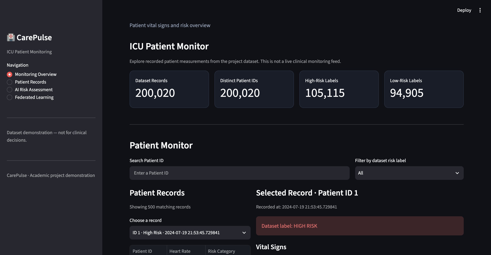
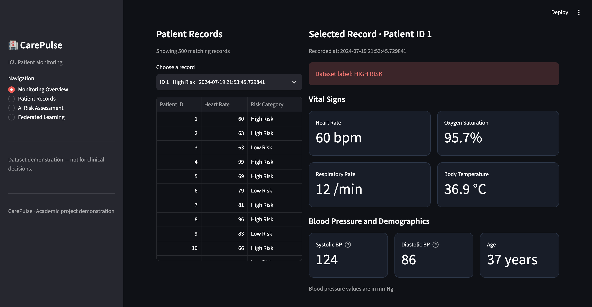
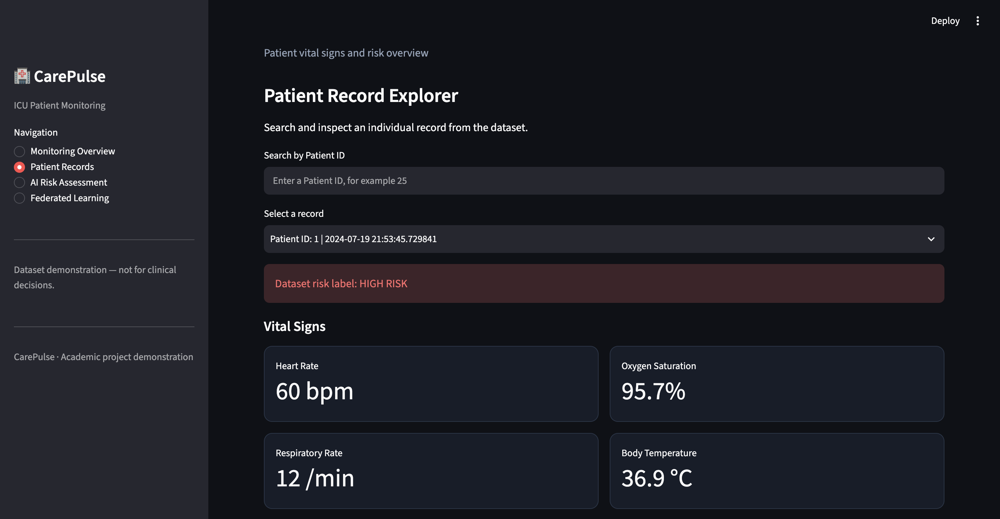
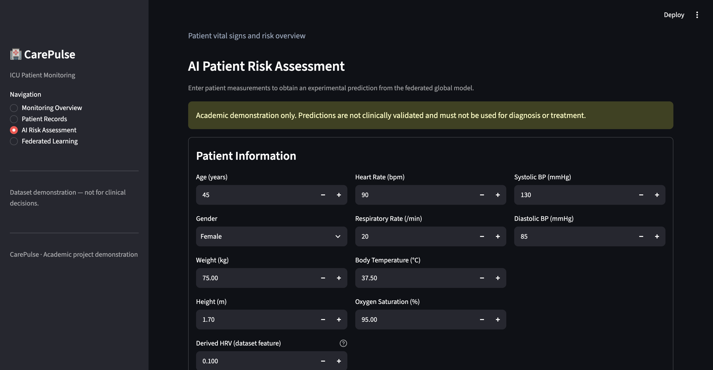
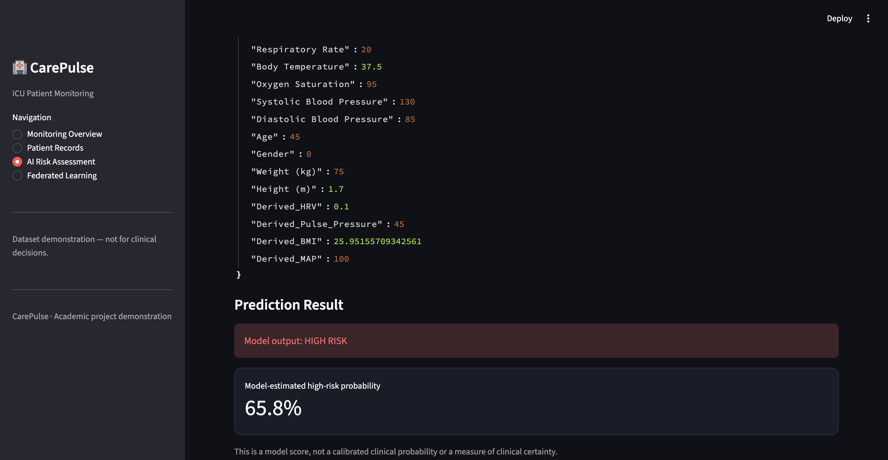
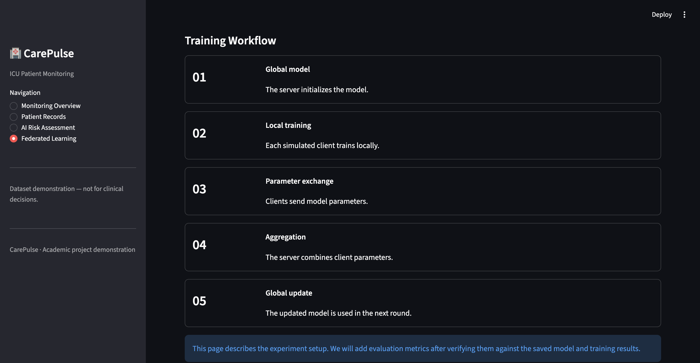

# Federated ICU Patient Risk Prediction

An academic machine learning project that explores **Federated Learning** for ICU patient risk classification using a logistic model trained across three simulated hospital clients. The project includes a Streamlit dashboard for exploring patient records and testing experimental risk predictions through a Flask API.

## Features

- **Federated Learning:** Simulates collaborative model training across three hospital clients using a FedAvg-style aggregation workflow.
- **Patient Monitoring Dashboard:** Explore vital-sign records, filter by patient ID and dataset risk label, and view available measurements over time.
- **AI Risk Assessment:** Submit patient measurements to a Flask API and display the model's predicted risk class and estimated high-risk score.
- **Data Preparation:** Prepare the dataset and split it into three hospital-specific CSV files.
- **Model Inference:** Load the saved global model and scaler for prediction.

## Technology Stack

- Python
- Pandas and NumPy
- Scikit-learn
- Flower (`flwr`)
- Flask and Flask-CORS
- Streamlit
- Jupyter Notebook

## Project Structure

```text
federated-icu-risk-prediction/
├── dashboard/
│   └── app.py
├── data/
│   ├── vitals.csv
│   ├── hospitalA.csv
│   ├── hospitalB.csv
│   └── hospitalC.csv
├── models/
│   ├── global_model.pkl
│   └── scaler.pkl
├── notebooks/
│   └── prepareData.ipynb
├── src/
│   ├── api.py
│   ├── clientA.py
│   ├── clientB.py
│   ├── clientC.py
│   ├── predict.py
│   ├── server.py
│   └── utils.py
├── .gitignore
├── requirements.txt
└── README.md
```

## Setup

### 1. Clone the repository

```bash
git clone <https://github.com/tanushaKatakam/Federated-ICU-Patient-Risk-Prediction>
cd federated-icu-risk-prediction
```

### 2. Create and activate a virtual environment

```bash
python -m venv .venv
source .venv/bin/activate
```

### 3. Install dependencies

```bash
python -m pip install -r requirements.txt
```

### 4. Run the Flask prediction API

Open a terminal at the project root:

```bash
python src/api.py
```

The API runs locally on port `5000`.

### 5. Run the Streamlit dashboard

Open a second terminal, activate the same virtual environment, and run:

```bash
streamlit run dashboard/app.py
```

Open the local URL displayed by Streamlit, usually `http://localhost:8501`.

Keep the Flask API running while using the dashboard's **AI Risk Assessment** page.

## Federated Learning Workflow

1. Prepare the dataset and divide it into three hospital-specific datasets.
2. Start the Flower server.
3. Start the three hospital clients.
4. Each client trains locally and sends model parameters to the server.
5. The server aggregates client parameters using a FedAvg-style strategy.
6. The saved model artifacts can be used for prediction.

The current client scripts expect `data/hospitalA.csv`, `data/hospitalB.csv`, and `data/hospitalC.csv`.

> **Note:** The training scripts, saved model, and notebook should be checked together before treating the training workflow as reproducible. The prediction API uses the saved model artifacts and does not itself run federated training.

## Important Limitations

- This is an **academic demonstration**, not a clinically validated medical system. Its predictions must not be used for diagnosis, treatment, or patient-care decisions.
- The displayed high-risk score is a model output and should not be interpreted as a calibrated clinical probability.
- `Derived_HRV` is currently supplied as a placeholder in the dashboard prediction flow. Heart rate alone cannot establish true heart-rate variability; actual HRV measurement requires beat-to-beat interval data.
- The project simulates three hospital clients. It does not establish that the system has been deployed in real hospitals or meets healthcare privacy or regulatory requirements.
- Model performance depends on the dataset, preprocessing, and training procedure. Further validation is required before drawing clinical conclusions.

## Future Improvements

- Make the federated training workflow reproducible from a clean environment.
- Add automated tests for data preparation, API validation, and prediction.
- Document model evaluation using a consistent held-out test procedure.
- Improve experiment tracking and model versioning.
- Replace placeholder features with valid measurements where suitable data is available.

## Disclaimer

This project is intended for educational and research purposes only. It is not a medical device and is not intended for clinical use.

## Dashboard Screenshots

### Monitoring Overview



### Patient Vital-Sign Charts



### Patient Records



### AI Risk Assessment — Input Form



### AI Risk Assessment — Prediction Result



### Federated Learning


